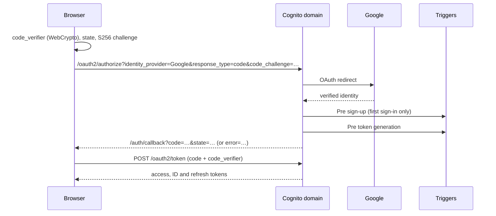

# Contract: Sign-in, allowlist and revocation

Covers FR-041 to FR-048, FR-052 to FR-054 and SC-014 to SC-018. Decision: research Q9. Entities: [data-model.md](../data-model.md).

## Cognito resources (`cognito-stack.ts`, rewritten)

| Resource | Setting | Why |
| --- | --- | --- |
| User pool | Feature plan **Lite**. Native sign-up and password sign-in disabled. | Q9. The Lite MAU free tier being Always Free is human-read required (FR-051). |
| Identity provider | Google (built-in social). Attribute mapping: `email` ← `email`, `email_verified` ← `email_verified`. Nothing else is mapped. | FR-043 needs `email_verified`. Storing less narrows FR-053's disclosure. |
| Google authorize scopes | `openid email` | The least that yields a verified email. `profile` is not requested, because no profile field is used. |
| App client | Public (no secret). Authorization-code grant only. PKCE required. Supported IdPs: `Google` only. OAuth scopes: `openid`, `email`. Token revocation enabled. | Q9; SC-017 |
| Callback URL | `https://max.recipieces.com/auth/callback` | FR-048 |
| Sign-out URL | `https://max.recipieces.com/` | FR-048 |
| Domain | Cognito prefix domain `<prefix>.auth.us-west-2.amazoncognito.com` | Q9; FR-049 |
| Token validity | Cognito defaults, unchanged | Revocation does not depend on token lifetime (below) |
| Identity Pool and its roles | **Removed** | FR-041; Q1 (no browser AWS credentials) |
| Triggers | Pre sign-up, pre token generation (V1 event) | FR-042; Q9 |

`http://localhost` callbacks are added only to a local development app client, never to the deployed client (FR-048).

**Deploy-time values.** The domain prefix and the Google client ID are public, because both appear in the browser's sign-in redirects. They are committed as constants in `cognito-stack.ts`, and asserted in `cognito-stack.test.ts`, once the builder has chosen the prefix and registered the client ([quickstart.md](../quickstart.md) § Prerequisites). A prefix must be unique in the Region and must not contain `aws`, `amazon` or `cognito` ([AWS Security Blog: Cognito domain prefix](https://aws.amazon.com/blogs/security/how-to-set-up-amazon-cognito-for-federated-authentication-using-azure-ad/), read 2026-10-11). Only the client secret stays out of the repository (below).

### Google client secret (FR-052)

1. Before deploying, the builder stores the secret as an SSM SecureString, `/max-height/google-client-secret` (quickstart, Prerequisites).
2. The template never contains it. The custom resource `handlers/idp-secret.ts` reads the parameter on create and update, and calls `UpdateIdentityProvider` with `client_secret` in `ProviderDetails`.
3. A missing parameter **fails the deployment**.

The fallback is a Secrets Manager dynamic reference, at about $0.40 a month (human-read required). It is used only if the builder rejects the custom resource. **Builder to confirm** (plan, Complexity Tracking).

## Browser flow (`services/auth.ts`)

- **`identity_provider=Google`** sends the friend straight to Google, so Cognito's own pages are never shown.
- **`state`** is checked on return. A mismatch shows the sign-in error state and the code is discarded.
- **Storage**:
  - The access and ID tokens are kept **in memory** only.
  - The refresh token is kept in **`sessionStorage`**, so it survives a reload and dies with the tab.
  - Nothing goes to `localStorage` or a cookie.
- **Bearer**: the **access token** is sent as `Authorization: Bearer …` ([transport-sse.md](./transport-sse.md)). The runtime authorizer checks it with `allowedClients` = [app client ID]. Cognito access tokens carry `client_id`, not `aud`, so `allowedAudience` is not set.
- **Silent refresh (FR-047)**: before the access token expires, and once after any 401 or 403, the browser posts `grant_type=refresh_token`. If that fails, the friend sees the in-character signed-out state with a sign-in button. A mid-conversation expiry is never shown as a raw error.
- **Sign-out**:
  1. Revoke the refresh token at `/oauth2/revoke`.
  2. Clear memory and `sessionStorage`.
  3. Redirect to `/logout?client_id=…&logout_uri=…`.

## Triggers (Node.js 22 Lambdas; each fails closed)

### Pre sign-up (`handlers/pre-sign-up.ts`)

Runs once, when a federated user is first created (`triggerSource = PreSignUp_ExternalProvider`).

| Condition | Result |
| --- | --- |
| `email_verified` is not exactly `"true"` | Throw `DENIED` |
| `ALLOW#<lowercased email>` does not exist | Throw `DENIED` |
| A control-table read fails | Throw (deny) |
| Otherwise | Allow. `autoConfirmUser` stays false: federated users are confirmed by the provider. |

### Pre token generation (`handlers/pre-token-generation.ts`)

Runs at every sign-in and every refresh (V1 event; Lite plan).

| Condition | Result |
| --- | --- |
| `CONTROL#HALT` exists | Throw `DENIED` (hard stop; constitution P2) |
| `email_verified` is not exactly `"true"` | Throw `DENIED` |
| `ALLOW#<lowercased email>` does not exist | Throw `DENIED` (revocation at refresh) |
| A control-table read or write fails | Throw (deny) |
| Otherwise | Upsert `FRIEND#` with `email` and `provider`, and set `createdAt` if absent. Issue tokens unchanged; no claims are added. |

### Denial copy (FR-043)

Every denial uses one constant message, so the `error_description` on the callback never reveals whether an email is listed, or who is. The browser maps any callback `error` to the in-character denied state:

> This channel's invite-only, friend. If you think you should be on the list, ask the person who sent you the link.

The copy is final at task time, but it must not vary by cause.

## Runtime check (FR-042, first bullet)

At counted-session open, the runtime reads `FRIEND#` and then `ALLOW#<email>`. If either is missing, it refuses with `not_allowlisted` ([transport-sse.md](./transport-sse.md)). Continuing turns in an open counted session are not re-checked. Spec 001's 30-minute cap bounds them (FR-042, second bullet).

## Revocation timeline (SC-016)

| After `ALLOW#<email>` is deleted | Outcome |
| --- | --- |
| Next token refresh | Denied by pre token generation |
| Next counted-session open, even with a still-valid access token | Refused by the runtime check |
| A counted session open at removal | Ends within 30 minutes (spec 001 FR-010) |

## Allowlist operations (operator runbook)

These are AWS CLI commands against the control table, run with the builder's temporary credentials (P11). There is no admin UI, because P7 rules out self-service invitations.

| Operation | Effect |
| --- | --- |
| **Add** | `put-item` `ALLOW#<email>`. The email is the exact address the provider reports, lowercased. Gmail dot variants are not normalized, so add the address the friend actually uses. |
| **Remove** | `delete-item` `ALLOW#<email>` |
| **Delete on request** (FR-053) | Run in order: (1) invoke the memory pruner in single-friend mode with the friend's `sub` ([memory-api.md](./memory-api.md) § Pruner); (2) `admin-delete-user`; (3) delete `FRIEND#`, `SESSION#` and `ALLOW#<email>`. Record the date and the requester in the operator's log, not in the repository. |

## Privacy page (FR-053, `components/PrivacyPage.tsx`)

It discloses:

- **What is stored**: the email and Google subject ID (Cognito and the control table), the last-seen date, Max's extracted memories, and short-term conversation events.
- **Retention**:
  - Sign-in records are kept until deletion is requested or the friend is removed (P-07).
  - Memories are kept for 30 days after the last visit.
  - Short-term events are kept for 7 days.
  - Logs are kept for 14 days and never contain message text.
- **Your controls**: in-app "What Max remembers" (list and delete single memories), "Export" (a `.json` download) and "Forget me" (wipes memories and short-term events). While the service is paused for budget reasons, these are unavailable and deletion goes through the request route below.
- **How to request deletion**: the contact route the builder chooses, which is not committed if it is a personal address.

The page is reachable without signing in, because it is static content with no spend-bearing action.

## Third-party registration (FR-054)

The Google Cloud OAuth client is a web application with these settings:

- **Authorized redirect URI**: `https://<prefix>.auth.us-west-2.amazoncognito.com/oauth2/idpresponse`
- **Authorized JavaScript origin**: `https://<prefix>.auth.us-west-2.amazoncognito.com`
- **Consent screen scopes**: `openid` and `email`, both non-sensitive

The "Testing" status limits are **unverified**, and are checked during registration (quickstart, Prerequisites). Microsoft and Login with Amazon are deferred (P-02).
