# Data Model: Architecture Review and First AWS Deployment

**Feature**: `003-architecture-review` | **Date**: 2026-10-11 | **Plan**: [plan.md](./plan.md) | **Research**: [research.md](./research.md)

This feature has two kinds of entity:

- **Runtime entities**, which the deployment stores and enforces.
- **Review entities**, which are documentation records from spec Key Entities and live in `research.md` and on the wiki.

Hard numbers below are cited. None is introduced here.

## Runtime entities

### Control table (DynamoDB, one table)

The partition key is `pk` (string) and there is no sort key. The TTL attribute is `ttl` (epoch seconds). Provisioned capacity stays within the Always Free offer (human-read required, R-cost). The table name and ARN reach code only through configuration ([contracts/runtime-config.md](./contracts/runtime-config.md)).

| Item (`pk`) | Attributes | Written by | Read by |
| --- | --- | --- | --- |
| `ALLOW#<email>` | `provider` (`google`), `addedAt`, `addedBy` | Operator (documented CLI command) | Pre sign-up, pre token generation, runtime at session open |
| `FRIEND#` | `email`, `provider`, `createdAt`, `lastSeenAt`, `memoryPrunedAt` | Pre token generation (`email`, `provider`); runtime (`lastSeenAt` at session open); pruner (`memoryPrunedAt`) | Runtime, memory pruner |
| `SESSION#` | `sessionId`, `state`, `openedAt`, `turns`, `conversationalTokens`, `ttl` | Runtime | Runtime |
| `RATE##H#<yyyy-mm-ddThh>` and `RATE##D#<yyyy-mm-dd>` (UTC) | `count`, `ttl` | Runtime (atomic `ADD`) | Runtime |
| `SPEND#<yyyy-mm>` | `microUsd` (integer), `updatedAt` | Runtime (atomic `ADD`) | Runtime |
| `CONTROL#HALT` | `haltedAt`, `reason` | Hard-stop Lambda; the operator deletes it on recovery | Runtime, pre token generation |

Validation rules:

- **`email`** is lowercased and trimmed before any write or lookup. Only an email whose provider marks it verified is ever matched (FR-043).
- **`sub`** comes only from the token the runtime authorizer validated, or from the Cognito trigger event. It never comes from a request body (FR-010, #55).
- **`microUsd`** is an integer, so repeated `ADD`s never drift.
- **`RATE#…` windows** are fixed UTC hour and day windows with spec 001's limits: 60 messages an hour and 500 a day (`contracts/websocket-api.md:207-208`). `ttl` is the window end plus one window, so DynamoDB removes stale counters. A refused message is not counted.
- **`SESSION#.ttl`** is `openedAt` plus spec 001's 30-minute cap plus a grace window, for cleanup only. Expiry is evaluated in code, not by TTL, because TTL deletion is not immediate.

### Invited Friend

The spec's Invited Friend, made concrete as `FRIEND#` plus a matching `ALLOW#<email>`.

- **Identity**: the Cognito `sub` for the friend's federated user.
- **Access**: allowed only while `ALLOW#<email>` exists and `CONTROL#HALT` does not.
- **`lastSeenAt`**: updated when a counted session opens. It drives the 30-day memory window (spec 001 `data-model.md:165`; constitution `:236`).
- **Deletion on request** (FR-053):
  - delete the Cognito user
  - delete `FRIEND#`, `ALLOW#<email>` and `SESSION#`
  - wipe the memory namespace and short-term events

  The runbook is in [contracts/auth-and-allowlist.md](./contracts/auth-and-allowlist.md).

### Allowlist Entry

One per identity, meaning one provider plus one verified email, with no linking across providers (FR-046). Adding an entry grants access at the next sign-in. Removing it revokes access:

- No token refresh succeeds after removal (pre token generation).
- No counted session opens after removal (runtime check).
- An already-open session ends within spec 001's 30-minute cap (SC-016).

### Counted Session

The server-opened, server-counted session that carries spec 001's caps (FR-011):

- 50 turns
- 20,000 conversational tokens
- 30 minutes

There is at most one active session per `sub`.

```mermaid
stateDiagram-v2
    [*] --> Active: message from allowlisted sub,<br/>not halted, within rate limit
    Active --> Active: turn (any runtime session ID, strict continuity)
    Active --> SignedOff: turn or token cap reached<br/>(in-character sign-off)
    Active --> Expired: 30-minute cap elapsed<br/>(evaluated at next request)
    SignedOff --> Active: next message opens a new session<br/>(fresh cap; same rate limits)
    Expired --> Active: next message opens a new session
```

- **`conversationalTokens`** is the reply's `outputTokens`, measured from `result.metrics.accumulatedUsage`, plus the friend's message estimated at characters / 4 (P-09). A message is at most 2,000 characters (P-08).
- **A dropout** (runtime restart, redeploy or reclaim) does not change state. The friend's next message continues the same counted session under a new runtime session ID (strict continuity, P-05). In-session history is lost; long-term memories remain.
- **`HALT`** refuses every request in every state without changing state.

### Runtime Session (in-process)

An entry in the agent's in-memory registry (`session/agentRegistry.ts`), keyed by the runtime session ID header. That ID must be at least 33 characters (AgentCore Runtime documentation).

| Field | Meaning |
| --- | --- |
| `sub` | Owner. A request whose `sub` differs is refused with `session_mismatch`, and the entry is not reused. |
| `countedSessionId` | When it changes, for example after a sign-off, the `Agent` is rebuilt. History resets, and memories are retrieved again. |
| `agent` | A Strands `Agent` with the default `SlidingWindowConversationManager`, window 40 (`agent.d.ts:113`). |
| `lastUsedAt` | For local eviction when the microVM is shared or reclaimed. Spike S4 tests survival beyond 120 s idle. |

### Turn Usage

Computed per turn. It never comes from the client.

| Field | Source |
| --- | --- |
| `inputTokens`, `outputTokens`, `totalTokens` and the optional cache-read and cache-write counts | `result.metrics.accumulatedUsage` (`telemetry/meter.d.ts:141,149`; `Usage` at `models/streaming.d.ts:379-401`) |
| `pollyCharacters` | Characters sent to `SynthesizeSpeech`. Zero when voice is off. |
| `memoryEvents`, `memoryRetrievals` | Calls made this turn |
| `estimatedMicroUsd` | The sum of each count times its configured rate ([contracts/runtime-config.md](./contracts/runtime-config.md)), added to `SPEND#<yyyy-mm>` |

### Spend Signal

The spec's Spend Signal, made concrete in [contracts/spend-control.md](./contracts/spend-control.md).

| Kind | Source | Threshold source | Action | Recovery |
| --- | --- | --- | --- | --- |
| Alert | Budgets, gross of credits | P2: $5 and $8 | Email | None needed |
| Soft-degrade | `SPEND#` tally | $8 minus F (R-cost) | Voice off, text only | New month |
| Breaker | `SPEND#` tally | $10 minus F (R-cost) | Refuse turns, in character | New month, or the operator raises it with a recorded reason |
| Hard stop | Budgets 100% ACTUAL | P2: $10 | `CONTROL#HALT` plus a deny policy on the runtime role | Manual runbook |

### Memory (AgentCore Memory)

| Element | Definition |
| --- | --- |
| Memory resource | One `CfnMemory` with the built-in semantic, summary and user-preference strategies (spec 001 `data-model.md:73-89`) |
| Actor | `actorId` is the verified `sub` (FR-012) |
| Namespace | Prefix `/max-height/{actorId}/` (`memory/memoryAdapter.ts:57-59`), with per-strategy sub-paths `facts/`, `preferences/` and `summaries/{sessionId}/` ([contracts/memory-api.md](./contracts/memory-api.md)) |
| Short-term event | `actorId` and `sessionId` (the counted session); a conversational payload of the friend's message and Max's reply; `eventExpiryDuration` of 7 days (the service minimum) |
| Long-term record | `memoryRecordId`, `namespace`, content text, `createdAt`, strategy. There is no service expiry, so the pruner removes it 30 days after `FRIEND#.lastSeenAt` and then sets `memoryPrunedAt` |
| Ownership rule | Every list, export, delete or wipe resolves the namespace from the verified `sub`. A record whose namespace is outside that prefix is never touched (FR-013; fixes N3) |

## Review entities (documentation records)

| Spec entity | Where it lives |
| --- | --- |
| Decision Record (Q0–Q9) | `research.md` § Decision register; published as wiki `Decision-*` pages at close-out (FR-008) |
| Verification Citation, Wiki Claim Verification Record | `research.md` § Verification record and § Wiki discrepancies |
| Spike (S0–S4) | `research.md` § Spikes, with each approval recorded there before it runs |
| Deployment Environment | [quickstart.md](./quickstart.md) § Prerequisites (FR-033), plus `bin/app.ts` (pinned Region) |
| Issue Disposition | `research.md` § Issue dispositions |
